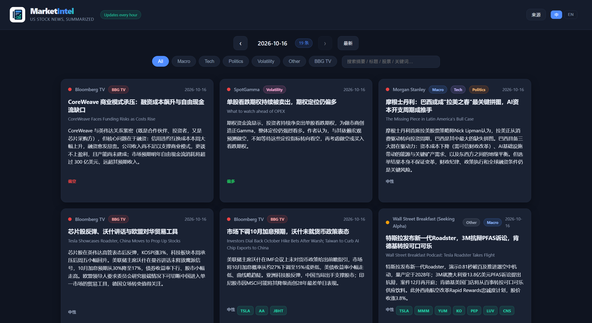
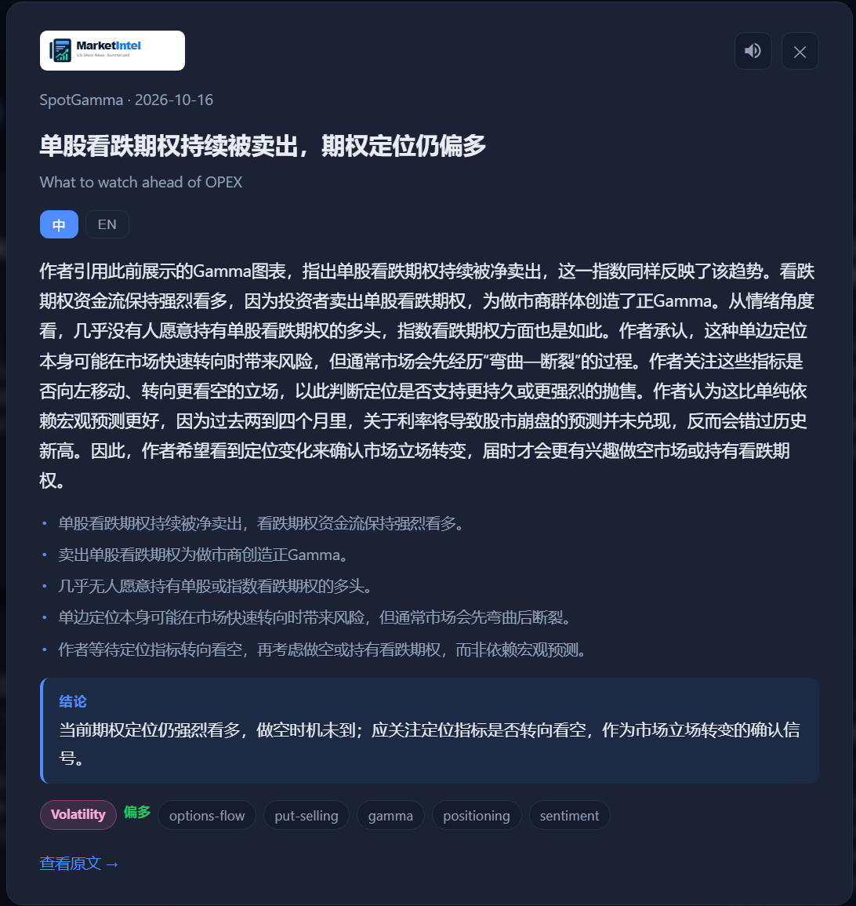

# MarketIntel — US Stock News, Summarized

A daily digest of public buy-side research, podcasts, and videos, summarized into bilingual (Chinese/English) US-equity insights by **DeepSeek**, and deployed as a public static site on **GitHub Pages** with hourly updates.

## Screenshots





## Features

- **7-day rolling window** — only the last 7 days of content are kept (older items are pruned on every run)
- **Newest-first** ordering
- **Bilingual** summaries, key points, details, and an investor **conclusion**
- **Multi-category** tagging: `macro`, `tech`, `politics`, `volatility`, `other`; Bloomberg TV is exclusively `bbg-tv-news`
- **Factual integrity** — the summarization skill forbids fabricating numbers, quotes, tickers, or events (see `src/llm/skill.py`)
- **Detail view** — click any card to expand the full insight

## Sources (24)

- **YouTube / podcasts (19)**: Bloomberg TV, SpotGamma, DoubleLine, Forward Guidance, Odd Lots, Patrick Boyle, Goldman Sachs, Trillions, Credit Edge, Ray Dalio, Animal Spirits, Morgan Stanley, The Memo (Howard Marks), BlackRock, Flirting with Models, CNBC, Real Vision, Excess Returns, The Big Take
- **Text (4)**: Wall Street Breakfast, Bond Vigilantes, FT Unhedged, The Derivative
- **PDF (1)**: Macro Voices

YouTube captions are fetched via **TranscriptAPI** (with a monthly credit budget, a hard stop on `402`, and live-stream / short-clip handling).

## Architecture

```
News_Agent/
├── config/sources.json          # source definitions (type/kind/feed/active)
├── src/
│   ├── config.py                # env vars + source loading
│   ├── state.py                 # JSON state (site/insights.json = data + dedup)
│   ├── ingest/                  # fetching: RSS / web / podcast / YouTube
│   ├── llm/deepseek.py          # DeepSeek bilingual summarization
│   └── pipeline/daily.py        # pipeline orchestration
├── site/                        # deployable static site
│   ├── index.html / style.css / app.js
│   └── insights.json            # generated data (committed; also the dedup state)
├── scripts/
│   ├── run_daily.py             # run one refresh -> updates site/insights.json
│   ├── serve.py                 # local preview (stdlib only)
│   └── register_task.ps1        # optional local Windows scheduled task
├── .github/workflows/daily.yml  # GitHub Actions: hourly refresh + Pages deploy
└── requirements.txt
```

**No server, no database.** The data is a single `site/insights.json` file, committed to git for persistence; the frontend reads and renders it directly. The same code runs locally and in GitHub Actions.

## Local usage

```powershell
# 1. env + deps
py -m venv .venv
.\.venv\Scripts\Activate.ps1
pip install -r requirements.txt

# 2. configure keys
Copy-Item .env.example .env   # fill in DEEPSEEK_API_KEY=sk-...

# 3. run one refresh (fetch -> summarize -> write site/insights.json)
python scripts\run_daily.py

# 4. local preview
python scripts\serve.py        # http://127.0.0.1:8000
```

## Deploy to GitHub Pages

### 1. Push the code

```powershell
git init
git add .
git commit -m "initial"
gh auth login
gh repo create news-agent --public --source=. --push
```

### 2. Configure secrets + Pages

```powershell
gh secret set DEEPSEEK_API_KEY --body "sk-your-key"
gh secret set TRANSCRIPT_API_KEY --body "your-transcript-api-key"

gh api --method POST repos/:owner/:repo/pages -f build_type=workflow
```

Replace `:owner`/`:repo` with your GitHub username / repo name.

### 3. Trigger the first deploy

```powershell
gh workflow run daily.yml
```

The site URL is `https://<username>.github.io/news-agent/`.

## How it works

The workflow runs **every hour**: checkout → install deps → `run_daily.py` (fetch the last 7 days → skip already-processed items → LLM bilingual summary → US-equity / econ-tech relevance check → prune old data → write `insights.json`) → commit data changes → deploy Pages.

When there is no new content, the pipeline skips persistence, so no spurious commit/deploy happens.

## Transcription

YouTube captions come from **TranscriptAPI** (paid, reliable from cloud IPs). Audio-only podcasts are transcribed locally with `faster-whisper` (see `src/ingest/transcribe.py`); `transcribe.py` includes a compat patch for the `av >= 19` `metadata_errors` removal.

## Environment variables

| Variable | Default | Description |
| --- | --- | --- |
| `DEEPSEEK_API_KEY` | — | Required |
| `DEEPSEEK_BASE_URL` | `https://api.deepseek.com` | OpenAI-compatible endpoint |
| `DEEPSEEK_MODEL` | `deepseek-chat` | Model name |
| `TRANSCRIPT_API_KEY` | — | TranscriptAPI key for YouTube captions |
| `TRANSCRIPT_MONTHLY_BUDGET` | `1000` | Monthly transcript credit budget |
| `MIN_TRANSCRIPT_DURATION` | `600` | Min duration (seconds) to fetch a transcript when over budget / duration-gated |
| `USE_YOUTUBE_CAPTIONS` | `1` | `1` = fetch captions, `0` = description-only |
| `DATA_DIR` | `data` | Local cache directory |

## Disclaimer

Content comes from public sources and is for research only — not investment advice.
